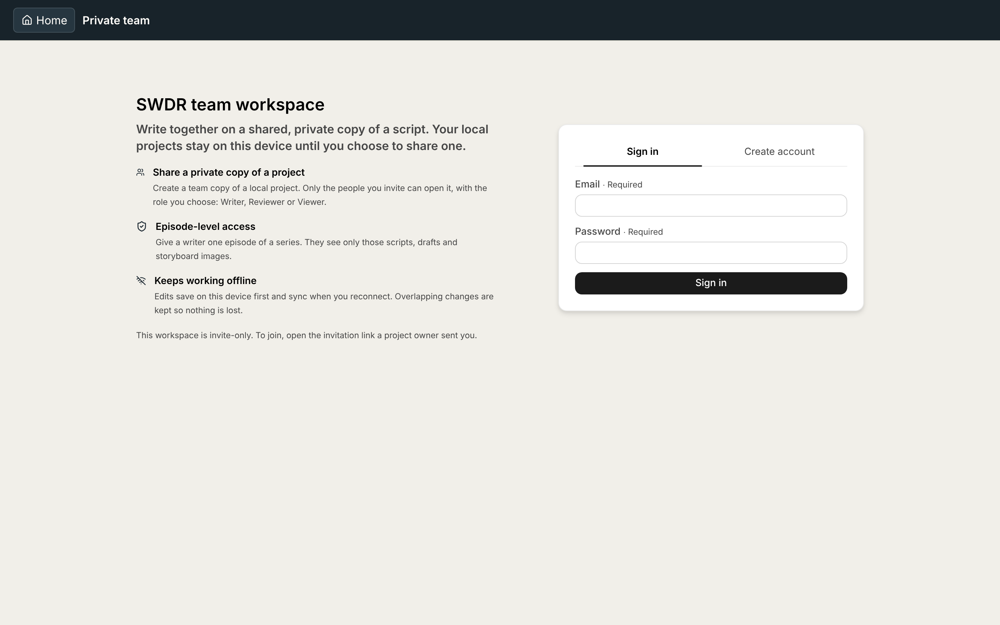
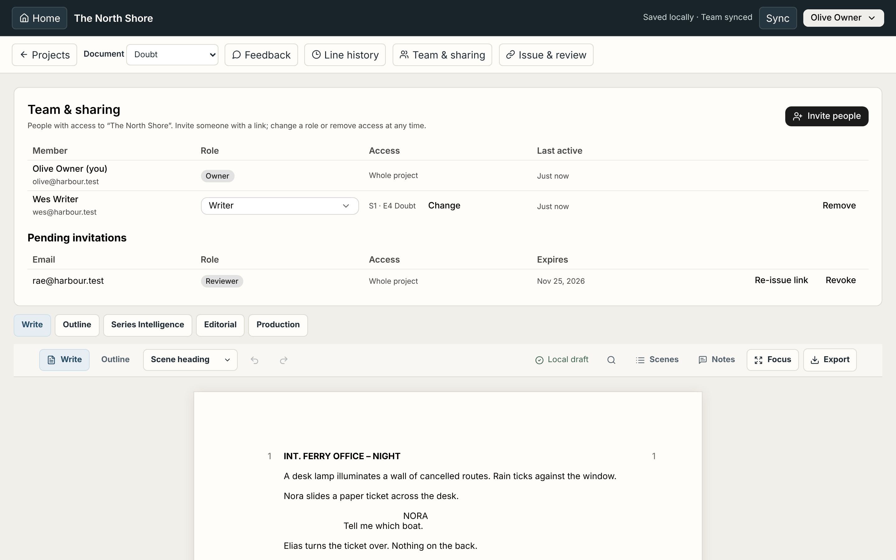
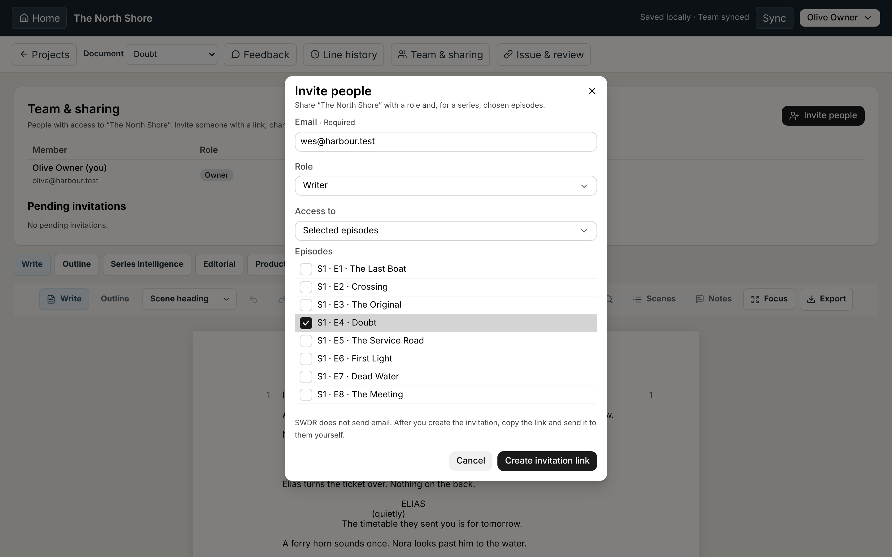
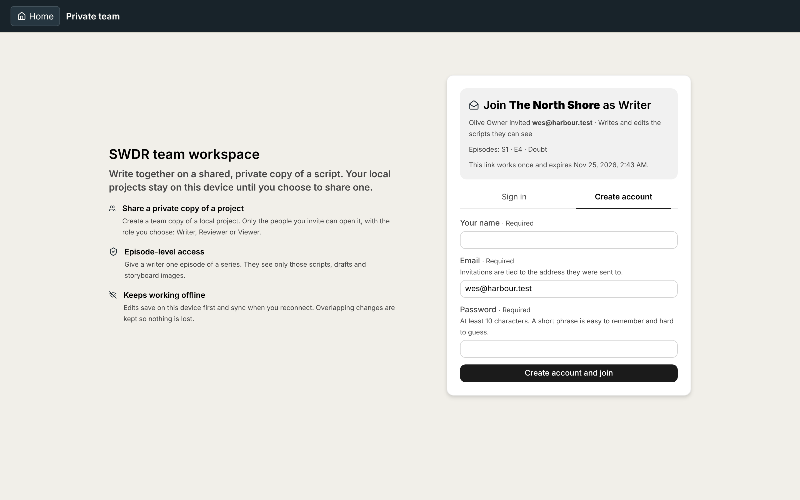

# Workspace data and private team setup

## Local work

Create or import a project from Home, edit the script, and reopen it after the save indicator confirms the local write. SWDR stores project state in IndexedDB under the browser origin. Recent edits also use a compact recovery journal when browser storage is available. Choose **Export archive** to back up projects beyond the current browser profile. The local project store checks for concurrent writes from another tab and keeps an edit pending if its saved base changed.

**Name draft**, **Stash** and **Issue** capture an immutable draft revision. Restore creates a new working revision and keeps the previous working copy in the draft history. The original issue and its block and scene IDs remain available to source links.

## Team workspace: accounts and sharing

A team workspace is a hosted, private copy of a project that several people edit together. Local projects never leave the device until an owner chooses **Create private copy**.



### How people join

1. **Owner signs up.** In an *open* workspace anyone can choose **Create account** at `/team` (or `#team`). In an *invite-only* workspace (the default) the first owner uses a workspace invitation link from the operator command below; everyone after that joins through a project invitation.
2. **Owner shares a project.** In **Private team**, choose a local project under **Share a local project** and **Create private copy**. The owner can now open **Team & sharing**.
3. **Owner invites people.** **Team & sharing → Invite people**: enter an email, choose a role and, for a series, *Whole project* or *Selected episodes*, then **Create invitation link**. SWDR does not send email: copy the link (`https://<your-app>/#team?invite=…`) and send it yourself. Each link works once, only for that email address, and expires after 7 days.
4. **Invitee joins.** Opening the link shows **Join <project> as <role>** with the inviter, scope and expiry. Someone without an account creates one (the email is fixed to the invited address); someone with an account signs in and joins in the same step. A person who is already signed in with the matching email accepts with one click. They land in the project and see only what their role and scope allow.
5. **Owner manages access.** The members list shows name, email, role, episode access and last activity. Owners change a role with the role menu, change episode access with **Change**, and **Remove** access after a confirmation. Pending invitations can be **Re-issued** (a new link; the old one stops working) or **Revoked**. Removing a member also revokes their pending invitations, and their cached copy is withdrawn the next time their browser syncs.





| Role | Stored as | Can |
|------|-----------|-----|
| Owner | `owner` | Edit everything, create review links, manage members and invitations |
| Writer | `editor` | Edit the scripts and drafts in their scope, issue drafts |
| Reviewer | `reviewer` | Read, comment and suggest line changes |
| Viewer | `viewer` | Read only |

Episode scope applies to Writer, Reviewer and Viewer. A scoped member sees only the documents, drafts and storyboard images of their episodes; whole-project story and production data is withheld. The account menu (top right) shows who is signed in and has **Sign out**; someone using a legacy access key can **Add a password** there.

### Security design

- **Passwords** are hashed with Node's `crypto.scrypt` (N = 2^15, r = 8, p = 1, 32-byte key, 16-byte random salt per user), compared with `timingSafeEqual`. Unknown emails run the same derivation against a decoy so timing does not reveal accounts. The scheme and parameters are stored with each hash so they can be raised later. Rules: 10–256 characters, not the email address, not a well-known password, not one repeated character. Emails are NFKC-normalised, trimmed and lower-cased.
- **Sessions** are random 256-bit tokens. Only their SHA-256 digest is stored, with an expiry (7 days for password sign-in, 12 hours for access keys). The cookie is `HttpOnly; Secure; SameSite=Strict; Path=/api/team` — Strict is a superset of Lax and the cookie is only needed by same-origin API calls. **Sign out** deletes the session row. A password session ends if the account is deleted; an access-key session ends when its key is removed from `SWDR_TEAM_ACCOUNTS`.
- **Invitation links** carry a 256-bit single-use token in the URL fragment (never sent to servers or logs). The database keeps only its digest, the invited email, role, scope, inviter and expiry. Acceptance requires the matching email and locks the invitation row, so a link cannot be used twice.
- **Membership needs proof.** New people get access only through an invitation link. An owner cannot add an arbitrary account by typing its email (operator-provisioned access-key accounts excepted). A new account never inherits access left behind under the same email.
- **Brute-force protection.** Failed password sign-ins are counted per email (5 per hour) and per IP address (30 per hour) in `swdr_team_login_attempts`, keyed by SHA-256 of the email or address. Over the limit the scope is locked for 30 seconds, doubling per further failure up to 15 minutes. Account creation is limited to 10 per address per hour. Addresses come from Vercel's `x-real-ip`/`x-forwarded-for`; a self-hosted deployment needs a proxy that overwrites those headers.
- **Cross-site requests.** Every call is a JSON `POST` to `/api/team` and must carry an `Origin` matching the host and, when present, `Sec-Fetch-Site: same-origin`. Responses are `Cache-Control: private, no-store`.

### Environment variables

| Variable | Required | Value |
|----------|----------|-------|
| `SWDR_TEAM_DATABASE_URL` | Yes | PostgreSQL connection string for the application role. Without it the team route answers 503. |
| `SWDR_TEAM_SIGNUP` | No | `invite` (default): accounts only through a valid invitation link. `open`: anyone can create an account and sees only projects they own or were invited to. Any other value disables the workspace. |
| `SWDR_TEAM_ACCOUNTS` | No | Legacy operator-provisioned access keys: JSON mapping each email to the SHA-256 hex digest of a 32-byte key. Existing deployments keep working unchanged. Leave unset when everyone uses passwords. |

Set them as server-side, sensitive variables. Never prefix them with `VITE_`.

### Schema migration

`server/team-schema.sql` is idempotent: it uses `CREATE TABLE IF NOT EXISTS`, `ALTER TABLE … ADD COLUMN IF NOT EXISTS` and `CREATE INDEX IF NOT EXISTS` in one transaction, so it upgrades an existing database in place and can be re-run safely. This version adds:

- `swdr_team_users` (email, name, created, last active) and `swdr_team_credentials` (scheme, salt, hash; deleted with the user)
- `swdr_team_invitations` (token digest, project or workspace invitation, email, role, episode scope, inviter, expiry, accepted/revoked)
- `swdr_team_login_attempts` (hashed scope, failure count, window, lock)
- `swdr_team_sessions.method` and `.created_at`, `swdr_team_grants.added_at`, and indexes on session email/expiry and grant email

To disable an account, delete its row from `swdr_team_users` (its password and sessions stop working) and remove its rows from `swdr_team_grants`.

### Set up your team workspace on Vercel

1. **Deploy SWDR** from your repository branch as a Vercel project. Optionally enable Vercel Deployment Protection while you test; anyone you invite then also needs Vercel access.
2. **Create a PostgreSQL database.** In the Vercel dashboard open **Storage → Create Database** (or the **Marketplace**) and choose a Postgres provider such as **Neon**. Connect it to the project. Use a dedicated database for SWDR.
3. **Set `SWDR_TEAM_DATABASE_URL`.** Copy the pooled connection string from the provider into **Settings → Environment Variables** as a sensitive variable for Production (and Preview if wanted). If the integration created it under another name (for example `DATABASE_URL`), add `SWDR_TEAM_DATABASE_URL` with the same value.
4. **Apply the schema** from a checkout, with the connection string in your shell environment (not typed into a command that is logged):

   ```bash
   psql "$SWDR_TEAM_DATABASE_URL" --set ON_ERROR_STOP=1 --file server/team-schema.sql
   ```

   Re-run the same command after upgrading SWDR; it only adds what is missing.
5. **Choose `SWDR_TEAM_SIGNUP`.** Keep `invite` (or leave it unset) for a private workspace. Use `open` only if you want anyone with the URL to create an account.
6. **Redeploy** so the function picks up the variables.
7. **Create the first owner account.**
   - *Invite-only:* from a checkout with dependencies installed (`npm ci`), issue a workspace invitation for yourself and open the printed link:

     ```bash
     node --import tsx server/team-admin.ts invite you@example.com --origin https://your-app.vercel.app
     ```

     The link lets that email create an account once within 7 days (`--days 1-30` to change). Only its digest is stored, so keep the printed link private.
   - *Open:* go to `https://your-app.vercel.app/team`, choose **Create account**.
8. **Share a project and invite people.** Open **Private team**, choose **Create private copy** for a local project, then **Team & sharing → Invite people**. Copy each link and send it privately.

For a hosted smoke test, use separate browser profiles for the owner and a writer: edit distinct lines, then the same line, and observe sync and conflict handling; take one writer offline, edit, reconnect; check line history, suggestions, role changes and access removal. Use production HTTPS for deployed team access.

### Local development

`vercel dev` from a Vercel-linked checkout serves the app and `/api/team` with your environment variables. Without Vercel, the test server serves `dist/` and mounts the real handler on a throwaway embedded PostgreSQL:

```bash
npm run build
node --import tsx tests/support/team-server.ts                          # http://127.0.0.1:4180, invite-only
SWDR_TEAM_SIGNUP=open PORT=4181 node --import tsx tests/support/team-server.ts
```

Project updates have retry IDs and database transaction locks. A rebase can merge distinct block changes and detect overlapping moves or edits. Feedback and line history are scoped to an accessible document. Accepting a suggestion checks that its original line is still current. Review access uses an expiring, revocable link to one issued script. Sign out after pending edits sync or are resolved.

## Verification and current bounds

Unit tests (`npm test`) include `server/team-model.test.ts` and `server/team-accounts.test.ts`: snapshot restore, scoped documents and assets, five writers' line merges, overlapping edits, access keys, idempotent retries, grant changes, HTTP origin enforcement, scrypt hashing and salts, password rules, token format and digests, sign-up mode parsing, throttling backoff and lockout, session expiry and revocation rules, invitation role/scope validation and single-use acceptance.

The PostgreSQL suites need a fresh loopback database named `swdr_test_*` in `SWDR_TEST_DATABASE_URL` and skip without one. `tests/support/team-postgres.ts` provides one: it starts the pinned `embedded-postgres` devDependency (as the `postgres` system user when run as root) on a free port with a random password, runs the command, and deletes the cluster.

```bash
node --import tsx tests/support/team-postgres.ts \
  node --import tsx --test server/team-model.test.ts server/team-accounts.test.ts server/team-postgres.test.ts server/team-accounts-postgres.test.ts
```

`server/team-accounts-postgres.test.ts` applies the schema twice, bootstraps an owner through a workspace invitation, invites a scoped writer, checks the members list, role downgrade, scope widening, re-issue/revoke/expiry of invitations, one-click acceptance, open sign-up isolation, refusal of inherited grants and of access-key emails, sign-in lockout, sign-out and expiry, member removal, and access-key accounts adding a password.

`tests/team-accounts.spec.ts` drives two Chromium profiles against the built app, the real handler and embedded PostgreSQL (`npm run build` first). The owner signs up through an invite-only bootstrap link, creates a team copy of the demo series, invites a writer to one episode and copies the link; the writer creates an account through the link, sees only that project and episode and edits it; the owner turns the writer into a viewer (the editor becomes read-only and the server refuses a save), removes them (their copy is withdrawn), and the writer signs out. `SWDR_TEAM_SCREENSHOTS=1` refreshes the `docs/screenshots/team-*.png` images.

Results on 2026-11-18 (Linux x86-64, Node 22.23, embedded PostgreSQL 18.6): typecheck and lint clean; `npm test` 61 passed and 2 skipped (the PostgreSQL suites without a database); the four team suites against PostgreSQL 35 passed; the browser suite 24 passed including the team end-to-end test.

The hosted service uses short polling and retains 100 recent merge bases. After the merge window, reopen the current draft and stash any conflicting script before editing. The IndexedDB team cache resumes the active draft for up to 12 hours from its last confirmed online access. A disconnected machine cannot check revocation until it reconnects. The browser clears a cached draft when the server reports that access was withdrawn. The hosted request size is 4 MB including embedded assets and drafts. Use local archive storage for larger projects. SWDR has no email service: invitation links are delivered by the owner, and there is no self-service password reset yet. To reset one, an operator deletes the person's `swdr_team_users` and `swdr_team_grants` rows and the project owners invite them again.
